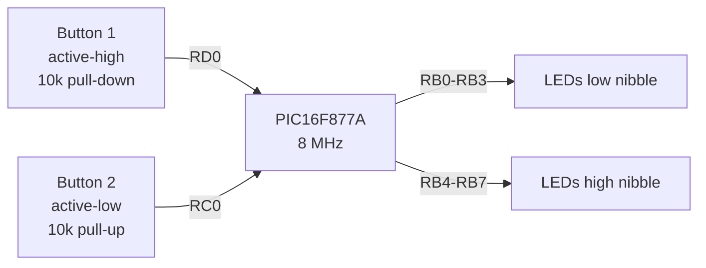
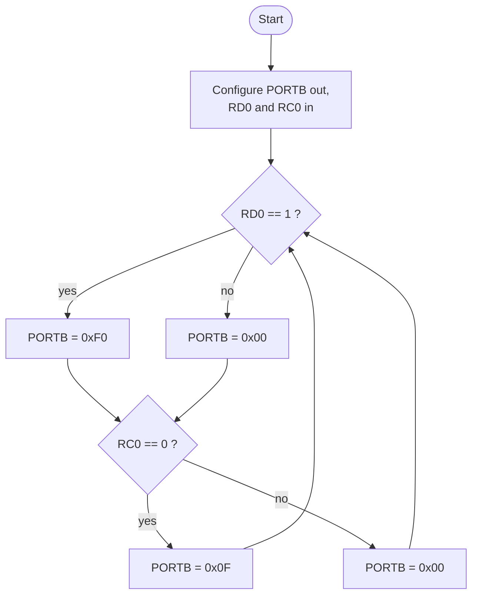

# Microcontroller-Button

Reading push-buttons with the PIC16F877A and showing the result on LEDs. Two buttons are used: one wired **active-high** and one wired **active-low**.

## Target hardware & settings

| Setting | Value |
|---|---|
| Microcontroller | **PIC16F877A** |
| Clock | 8 MHz crystal (HS) |
| Compiler / IDE | mikroC PRO for PIC |
| Config word | `0x2F4A`: HS oscillator, WDT off, PWRT off, BOR on, LVP off, no code protection |

## Pin map

| Pin | Direction | Connected to |
|---|---|---|
| RB0–RB7 | Output | 8 LEDs (with resistors to GND) |
| RD0 | Input | Button 1, **active-high** (pull-down resistor, press = 1) |
| RC0 | Input | Button 2, **active-low** (pull-up resistor, press = 0) |



## How the code works (`button.c`)

1. `TRISB = 0x00` makes PORTB an output, and the LEDs start off.
2. `TRISD = 0b00000001` and `TRISC = 0b00000001` make RD0 and RC0 inputs.
3. In the loop:
   - If **RD0 == 1** (button 1 pressed), `PORTB = 0xF0` lights the upper 4 LEDs. Otherwise PORTB = 0.
   - If **RC0 == 0** (button 2 pressed), `PORTB = 0x0F` lights the lower 4 LEDs. Otherwise PORTB = 0.



### Note
The second `if/else` always writes PORTB, so it overwrites what the first one wrote. When only button 1 is pressed, the upper LEDs light for just a few microseconds per loop and look dim or off. To make both buttons work independently, combine the two results:
```c
unsigned char out = 0;
if (PORTD.F0 == 1) out |= 0xF0;
if (PORTC.F0 == 0) out |= 0x0F;
PORTB = out;
```

## Build & flash
Open `button.mcppi` in mikroC PRO for PIC, build, and flash `button.hex`.
